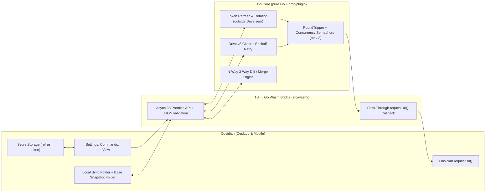

# `test-gdoc` — Goals, Design & Key Deliverables

## 1. Purpose & Context

`test-gdoc` is a feasibility spike and playground Obsidian plugin (`isDesktopOnly: false`) built on the **Go (WebAssembly) + TypeScript** template (`sample-go-plugin`). Its purpose is to validate the core technical building blocks needed for **`vault-share` v2.0**—specifically whether Google Drive API operations, OAuth token refresh, and N-way 3-way diff/merge business logic can live cleanly in **pure Go** compiled to Wasm and run reliably on **both Obsidian Desktop and Mobile**.

---

## 2. Agreed Architectural Decisions

| Area | Decision | Rationale |
| :--- | :--- | :--- |
| **Target Drive Files & Scope** | **Flat** plain files (`.md`, `.txt`) in `driveFolderPath`, `localSyncFolderPath`, and `baseSnapshotFolderPath` (no recursive subdirectories) | Matches `vault-share`'s text sync model, avoids lossy Google Docs conversion, and keeps the spike focused. |
| **OAuth & Mutual Exclusion** | Reuse `vault-share` OAuth client ID & Cloudflare relay (`https://vault-share-auth.bob-hyman.workers.dev`), `drive.file` scope; abort at `onload()` if `vault-share` is **installed or enabled** | Avoids new Google Cloud / relay infra while preventing `obsidian://vault-share-auth` handler collisions; `test-gdoc` also isolates `SecretStorage` under `test-gdoc-...` keys. |
| **Token Refresh & Rotation** | Performed in **Go** against `/google/token/refresh` **outside** the Drive concurrency semaphore; rotated `refresh_token` returned to TS | Keeps auth-lifecycle logic in Go, prevents semaphore/mutex deadlocks with in-flight Drive requests, and ensures TS persists rotated refresh tokens. |
| **HTTP Transport** | Pure-Go `http.RoundTripper` adapter (`go/gdrive/transport.go`) backed by a pluggable `DoFunc`; thin `syscall/js` binding calls TS `requestUrl()` | Bypasses CORS on Desktop (Electron) and Mobile (iOS WKWebView / Android WebView), while keeping the `RoundTripper` contract testable under native `go test ./go/...`. |
| **Concurrency & Rate-Limit Resilience** | Configurable concurrency semaphore (default `3`) gating raw Drive HTTP attempts (released before backoff sleep) + exponential backoff with jitter & `Retry-After` in **Go** | Keeps all protocol/rate-limit logic in Go (`go test`-able) and handles Drive `429`, `5xx`, and rate-limit `403` responses without holding slots during sleep. |
| **Drive Client** | Thin stdlib `net/http` + `encoding/json` Drive v3 client in pure Go | Avoids `google.golang.org/api` Wasm binary bloat and keeps core logic testable with `httptest.Server`. |
| **Obsidian Editing UX** | **Both**: (1) Command-driven Local Folder ↔ Drive Folder pull/push, and (2) Custom `ItemView` for direct Drive list/read/edit | Exercises native Obsidian editing (with 3-way merge) while using `ItemView` as a built-in "second device" remote simulator. |
| **3-Way Diff & Base State** | **Pure Go** N-way conflict merge engine (port of `vault-share`'s backtick-fenced format & folding); **base snapshots** seeded if missing (local file first, else Drive file), never overwritten automatically | Ensures a complete base set without overwriting manual user edits; prevents Markdown heading collisions and keeps merge logic in Go. |
| **Go ↔ TS Contract** | Codegen via `go/cmd/gents` (supporting scalars, slices, and nested structs) → `src/settings.generated.ts`; async Promise-based Wasm bridge | Single source of truth for both `PluginSettings` and shared RPC DTOs; non-blocking `requestUrl()` calls from Go goroutines. |

---

## 3. System Boundaries

- **TypeScript (`src/`)**: Plugin lifecycle (`main.ts`), mutual-exclusion guard, Settings UI (`settings.ts`), `ItemView` UI, OAuth browser redirect + `SecretStorage` wrapper (persisting initial and rotated refresh tokens), flat local vault & base-snapshot seeding/I/O, and a pass-through `requestUrl()` callback + Wasm bridge (`src/wasm/`).
- **Go (`go/`)**: Pure Go packages (free of `syscall/js`) for `http.RoundTripper` + concurrency-limited Drive v3 REST operations, exponential backoff retry, OAuth token refresh/rotation, and N-way 3-way text diff/merge; thin `syscall/js` glue in `go/cmd/plugin/` exposing async Promise-returning methods and wiring the JS `DoFunc`.

---

## 4. Key Deliverables

### Deliverable 1: Async Go ↔ TS `requestUrl()` Bridge
- Upgrade `GoWasmBridge` (`src/wasm/bridge.ts`) and `go/cmd/plugin/` to support:
  - Platform-independent `http.RoundTripper` adapter (`go/gdrive/transport.go`) backed by a pluggable `DoFunc`, plus a thin `//go:build js && wasm` `DoFunc` in `go/cmd/plugin/roundtripper.go`.
  - Pass-through TypeScript `httpFetch` callback wrapping Obsidian's `requestUrl({ ..., throw: false })` — slicing `Uint8Array` bodies via `body.buffer.slice(body.byteOffset, body.byteOffset + body.byteLength)` to an exact `ArrayBuffer`, and returning `new Uint8Array(response.arrayBuffer)` to Go.
  - Async TS-to-Go calls returning JS `Promise`s so Go goroutines can await `requestUrl()` without deadlocking the JS event loop.
- **Verification**: Vitest unit tests mocking `requestUrl()` (verifying exact `ArrayBuffer` slicing and headers) + native `go test ./go/...` unit tests for `go/gdrive/transport.go`.

### Deliverable 2: Pure Go Auth Refresh, Concurrency Limiter & Drive v3 Client
- `go/gdrive` (pure Go package):
  - Configurable concurrency limiter (semaphore of size `maxPendingRequests`, default `3`) gating individual raw Drive HTTP attempts inside `transport.go`/`client.go`, releasing the slot **before** retry backoff sleep.
  - `TokenManager` performs access-token refresh via `https://vault-share-auth.bob-hyman.workers.dev/google/token/refresh` **outside** the Drive request semaphore (avoiding any deadlock with in-flight Drive requests), surfaces any rotated `refresh_token` back to TS for `SecretStorage` persistence, and handles single `401` invalidation/retry.
  - Exponential backoff + jitter + `Retry-After` retry policy for transient errors (`429`, `500`, `502`, `503`, `504`, and `403` with `rateLimitExceeded` / `userRateLimitExceeded`).
  - Drive v3 operations over `net/http` for **flat** `.md`/`.txt` files: resolve/create `driveFolderPath`, list `.md`/`.txt` children, read file content, create/update file content (multipart upload).
- **Verification**: `go test ./go/...` using `net/http/httptest.Server` (covering `RoundTripper` contract, concurrency cap, retry/backoff, token rotation, 401 retry without semaphore deadlock, and CRUD operations).

### Deliverable 3: Pure Go N-Way 3-Way Diff/Merge Engine
- `go/merge` (pure Go package, ported from `vault-share`'s `src/sync/nway-merge.ts`):
  - Uses Markdown-safe backtick-fenced conflict markers (`` `<<<<< conflict` ``, `` `===== base` ``, `` `===== A1` ``, `` `>>>>> conflict` ``).
  - Supports clean 3-way merges (`diff3`) as well as N-way conflict parsing and folding (`ReconcileText`: folding new contributions into an existing conflicted file without feeding conflict markers back into `diff3`, falling back to `keepBoth` when malformed or out-of-span).
- **Verification**: Table-driven `go test` cases covering clean merges, identical edits, deletions, fresh conflict minting, N-way folding (`A1`/`A2`/`A3`), and `keepBoth` fallbacks.

### Deliverable 4: Auth & Vault Folder Integration (TypeScript)
- **Mutual exclusion guard**: At startup (`onload`), detect whether `vault-share` is **installed or enabled** (`manifests['vault-share'] || enabledPlugins.has('vault-share')`); if so, display an error notice and abort initialization immediately.
- Reuse `vault-share`'s OAuth login flow in TS (browser redirect + `SecretStorage` with `test-gdoc-<vault>-...` keys, updating `SecretStorage` whenever Go reports a rotated refresh token).
- Extend `go/cmd/gents` to support slices and nested structs so both `PluginSettings` (`driveFolderPath`, `localSyncFolderPath`, `baseSnapshotFolderPath`, `maxPendingRequests`) and shared Go ↔ TS RPC DTOs are generated in `src/settings.generated.ts`.
- TS vault adapter for flat `.md`/`.txt` files in `localSyncFolderPath` and `baseSnapshotFolderPath`:
  - **Complete base-snapshot seeding (non-destructive)**: at startup (`onLayoutReady`), copy any flat `.md`/`.txt` file in `localSyncFolderPath` missing from `baseSnapshotFolderPath` into `baseSnapshotFolderPath` (pure local I/O so Wasm stays lazy); when Drive files are fetched (on Pull/Push), seed any remaining Drive file missing from `baseSnapshotFolderPath` using the local file if present, else the Drive file. Never overwrite an existing base file—after seeding, base files are managed manually by the user.
- **Verification**: Vitest unit tests for the vault/base-snapshot seeding & non-overwrite behavior and auth/rotation persistence.

### Deliverable 5: Obsidian UX — Commands & Direct Drive `ItemView` (Remote Simulator)
- **Command-driven flat folder sync**:
  - `Pull Google Drive folder`: lists & pulls flat `.md`/`.txt` files into `localSyncFolderPath`, and seeds any missing base files in `baseSnapshotFolderPath` (never overwriting existing base files).
  - `Push active note to Google Drive`: reads the active flat `.md`/`.txt` note and its base snapshot from `baseSnapshotFolderPath` (seeding missing base from local/Drive if absent), invokes Go's N-way 3-way merge (`ReconcileText`), and handles each outcome:
    - `clean` / `folded`: writes merged content to Drive (if changed) and the local note.
    - `keepBoth`: leaves both Drive and the local note untouched, writes the remote version alongside the local note as `<stem> (remote conflict).<ext>`, and notifies the user.
    - Existing base files in `baseSnapshotFolderPath` are never overwritten automatically.
- **Direct Drive `ItemView` (built-in "second device" simulator)**:
  - Side/tab view listing flat `.md`/`.txt` files in `driveFolderPath`, opening a selected file in an editor pane, and saving edits directly back to Drive **without touching `localSyncFolderPath` or `baseSnapshotFolderPath`**.
  - This intentionally allows simulating concurrent remote edits from another device inside a single Obsidian window to test 3-way merge end-to-end.

### Deliverable 6: Feasibility Report & Benchmarks
- Measure `main.js` production bundle size and lazy Wasm initialization latency.
- Verify end-to-end list, read, write, and N-way 3-way conflict resolution on **Obsidian Desktop** and **Obsidian Mobile** (Android/iOS).

---

## 5. Non-Goals (Out of Scope for `test-gdoc`)
- Recursive subfolder traversal (flat `.md`/`.txt` files only).
- Automatic overwriting/advancing of existing base snapshots after conflict or push (seeded only when missing; otherwise updated manually by the user).
- Automated background file watchers, periodic sync timers, or monitor mode (`vault-share` v1 features).
- Multi-device deletion propagation or IndexedDB sync history stores.
- Native Google Docs (`application/vnd.google-apps.document`) conversion.
- Automated WebdriverIO (`wdio`) e2e test suite.
