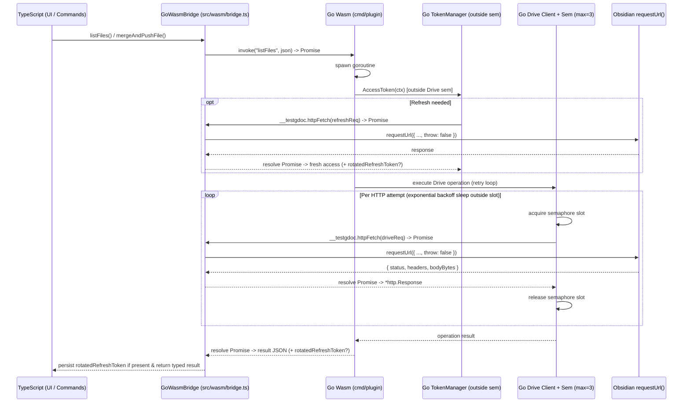

# Implementation Plan: `test-gdoc` (Go/Wasm Google Drive & N-Way 3-Way Merge Plugin)

## Goal Description

Implement the core feasibility deliverables defined in [design-deliverables.md](file:///shares/src/obsidian/test-gdoc/design-docs/design-deliverables.md) for `test-gdoc`:
1. An async **Go ↔ TypeScript `requestUrl()` bridge** with a pure-Go, natively testable `http.RoundTripper` adapter (`go/gdrive/transport.go`) and a thin `syscall/js` `DoFunc` calling Obsidian's `requestUrl()`, bypassing CORS on Obsidian Desktop and Mobile.
2. A **pure Go Google Drive v3 client + OAuth token refresher** (`go/gdrive`) using standard `net/http` and `encoding/json`, including a **Go-side concurrency limiter** (default `3`, gating only raw Drive HTTP attempts and releasing before backoff sleep), **token refresh outside the Drive semaphore** (preventing mutex/semaphore deadlocks), **exponential backoff + jitter + `Retry-After`**, and **rotated `refresh_token` propagation** back to TypeScript for `SecretStorage` persistence.
3. A **pure Go N-way 3-way diff/merge engine** (`go/merge`) ported from `vault-share`'s `src/sync/nway-merge.ts`, using Markdown-safe backtick-fenced markers and folding new contributions without feeding existing conflict markers back into `diff3`.
4. **Obsidian integration** scoped to **flat `.md`/`.txt` files only**: a startup mutual-exclusion guard that aborts if `vault-share` is installed (`manifests['vault-share']`) or active, OAuth login + `SecretStorage` (`test-gdoc-...` keys), non-destructive base-snapshot seeding (local first, else Drive; never overwriting existing user-managed base files), command-driven pull/push with explicit `keepBoth` conflict-copy handling, and a custom `ItemView` for direct Drive editing (acting as a built-in remote simulator).
5. **Automated tests & feasibility benchmarks**: `go test ./go/...`, `vitest` unit tests, `npm run build`, `npm run lint`, and `main.js` size / Wasm init latency measurements.

---

## User Review Required

> [!IMPORTANT]
> **DevDependency Addition (`vitest`)**: To run TypeScript unit tests for the `requestUrl()` bridge, auth/rotation handling, and vault seeding/sync adapter, this plan adds `vitest` as a `devDependency` and a `"test": "vitest run"` script in `package.json`.

> [!WARNING]
> **Replaces Sample Go/TS Scaffold**: The existing sample `GreetingPrefix`/`RepeatCount`/`Uppercase` settings and `RunAction` demo in `go/settings/settings.go` and `src/settings.ts` will be replaced with `test-gdoc`'s Drive, sync-folder, base-snapshot-folder, and concurrency settings.

> [!NOTE]
> **OAuth Mutual Exclusion (`vault-share`)**: Even installing `vault-share` in the same vault (`manifests['vault-share']` or `enabledPlugins.has('vault-share')`) will cause `test-gdoc` to show an error `Notice`, log the conflict, and abort `onload()`. `test-gdoc` also isolates its own `SecretStorage` keys under a `test-gdoc-...` prefix.

---

## Proposed Changes

### 1. Shared Settings, RPC DTOs & Codegen (`go/settings/`, `go/cmd/gents/`)

Update the single-source-of-truth Go structs and extend `gents` to generate both settings and shared Go ↔ TS RPC DTOs into `src/settings.generated.ts`.

#### [MODIFY] [settings.go](file:///shares/src/obsidian/test-gdoc/go/settings/settings.go)
- Replace sample greeting fields with:
  ```go
  type PluginSettings struct {
  	DriveFolderPath        string `json:"driveFolderPath"`
  	LocalSyncFolderPath    string `json:"localSyncFolderPath"`
  	BaseSnapshotFolderPath string `json:"baseSnapshotFolderPath"`
  	MaxPendingRequests     int    `json:"maxPendingRequests"`
  }
  ```
- Defaults: `DriveFolderPath: "/test-gdoc"`, `LocalSyncFolderPath: "test-gdoc-sync"`, `BaseSnapshotFolderPath: "test-gdoc-base"`, `MaxPendingRequests: 3`.
- Add shared Go ↔ TS RPC DTO structs (all using scalars, slices, and nested structs):
  - `FileMeta` (`ID`, `Name`, `MimeType`, `ModifiedTime`, `Size`)
  - `ListFilesResult` (`FolderID`, `Files []FileMeta`, `RotatedRefreshToken`)
  - `ReadFileResult` (`File FileMeta`, `Content`, `RotatedRefreshToken`)
  - `WriteFileResult` (`File FileMeta`, `RotatedRefreshToken`)
  - `MergeAndPushRequest` (`FolderPath`, `FileName`, `BaseContent`, `LocalContent`, `HasBase`)
  - `MergeAndPushResult` (`Outcome` — `"clean" | "folded" | "keepBoth" | "noop"`, `Content`, `RemoteContent`, `DriveUpdated`, `File FileMeta`, `RotatedRefreshToken`)
- Keep pure-Go validation helpers (e.g., clamping `MaxPendingRequests` to `1..10`).

#### [MODIFY] [main.go](file:///shares/src/obsidian/test-gdoc/go/cmd/gents/main.go)
- Extend `goTypeToTS` to support `reflect.Slice` (`<elemType>[]`) and `reflect.Struct` (named TypeScript interfaces) in addition to scalar kinds.
- Emit `PluginSettings`, `DEFAULT_SETTINGS`, and all shared RPC DTO interfaces into `src/settings.generated.ts`.

#### [MODIFY] [settings_test.go](file:///shares/src/obsidian/test-gdoc/go/settings/settings_test.go)
- Update Go unit tests to verify `DefaultSettings()`, validation helpers, and JSON round-trip of `PluginSettings` and shared DTOs.

---

### 2. Async Go ↔ TS `requestUrl()` Bridge (`src/wasm/`, `go/cmd/plugin/`)

Enable Go goroutines to make `net/http` calls via a pass-through to Obsidian's `requestUrl()`, while all concurrency throttling, token refresh, and retry logic live in Go.



#### [MODIFY] [types.ts](file:///shares/src/obsidian/test-gdoc/src/wasm/types.ts)
- Update `WasmBridgeApi` to expose async Promise-returning Go methods:
  - `invoke(method: string, payloadJson: string): Promise<string>`
  - `shutdown(): void`
- Add `HttpRequestPayload` (`method`, `url`, `headers`, `body?: Uint8Array`) / `HttpResponsePayload` types and the pass-through `httpFetch` callback signature on `WasmWindowGlobals`.

#### [MODIFY] [bridge.ts](file:///shares/src/obsidian/test-gdoc/src/wasm/bridge.ts)
- Register the pass-through `httpFetch` callback wrapping Obsidian's `requestUrl({ ..., throw: false })` before calling `go.run(...)`:
  - When `req.body` (`Uint8Array`) is non-empty, pass an exact sliced `ArrayBuffer` via `req.body.buffer.slice(req.body.byteOffset, req.body.byteOffset + req.body.byteLength)`.
  - Return `{ status: response.status, headers: response.headers, body: new Uint8Array(response.arrayBuffer) }`.
- Expose typed async methods (`configure`, `listFiles`, `readFile`, `writeFile`, `mergeAndPushFile`, etc.) using `api.invoke(...)`, JSON parsing, and runtime `assert*` validators (no `any` casts).
- Whenever a Go RPC response includes a non-empty `rotatedRefreshToken`, invoke a registered callback so TS persists it to `SecretStorage`.
- Measure and log/expose Wasm lazy initialization duration (ms) for Deliverable 6 benchmarking.

#### [NEW] [roundtripper.go](file:///shares/src/obsidian/test-gdoc/go/cmd/plugin/roundtripper.go)
- `//go:build js && wasm`
- Thin `syscall/js` `gdrive.DoFunc` implementation:
  - Copies `req.Body` bytes into `js.Global().Get("Uint8Array")` via `js.CopyBytesToJS`.
  - Calls the registered JS `httpFetch` function and awaits the returned JS `Promise` via `then`/`catch` channels (respecting `req.Context().Done()`), returning `*gdrive.HTTPResponse` to the pure-Go transport adapter.

#### [MODIFY] [main.go](file:///shares/src/obsidian/test-gdoc/go/cmd/plugin/main.go)
- Wire `TokenManager` (using an un-throttled `gdrive.NewTransport(jsDoFunc, 0)` so token refresh never contends with the Drive semaphore) and `gdrive.Client` (using a semaphore-capped `gdrive.NewTransport(jsDoFunc, maxPendingRequests)`).
- Implement an async `invoke(method, payloadJson)` `js.Func` that spawns a goroutine and returns a JS `Promise` resolving/rejecting with JSON.
- Properly `Release()` all `js.Func` callbacks on `shutdown()`.

---

### 3. Pure Go Transport, Auth Refresh & Drive v3 Client (`go/gdrive/`)

Pure Go package with zero `syscall/js` imports, fully testable on native Linux via `go test ./go/...` and `net/http/httptest.Server`.

#### [NEW] [transport.go](file:///shares/src/obsidian/test-gdoc/go/gdrive/transport.go) & [transport_test.go](file:///shares/src/obsidian/test-gdoc/go/gdrive/transport_test.go)
- Platform-independent `Transport` implementing `http.RoundTripper` over a pluggable `DoFunc func(ctx context.Context, req *HTTPRequest) (*HTTPResponse, error)`:
  - Reads `req.Body` (if non-nil), flattens headers, invokes `DoFunc`, and reconstructs `*http.Response` with `StatusCode`, `Header`, and `Body: io.NopCloser(bytes.NewReader(resp.Body))`.
  - When configured with `maxPending > 0`, gates **only** the `DoFunc` call via a concurrency semaphore (releasing before any retry sleep or context cancellation). Includes `SetMaxPending(n int)` or dynamic semaphore gating.
- `transport_test.go`: Native `go test` verifying method, URL, headers, binary body round-trip, context cancellation, and concurrency cap (`maxConcurrentObserved <= maxPending`).

#### [NEW] [auth.go](file:///shares/src/obsidian/test-gdoc/go/gdrive/auth.go)
- `TokenManager`:
  - Uses its own un-throttled `*http.Client` (outside the Drive concurrency semaphore so Drive calls waiting on `AccessToken` can never deadlock against `/google/token/refresh`).
  - Stores `refreshToken`, `accessToken`, `expiresAt`, `relayBaseURL` (default `https://vault-share-auth.bob-hyman.workers.dev`), and surfaces any rotated `refresh_token` returned by `/google/token/refresh` so Go RPC responses return `RotatedRefreshToken` to TS.
  - `AccessToken(ctx context.Context) (accessToken string, rotatedRefreshToken string, err error)`: deduplicates concurrent refreshes via `sync.Mutex`.
  - `Invalidate()`: clears cached access token so the next call forces a refresh (used on `401 Unauthorized` retry).

#### [NEW] [client.go](file:///shares/src/obsidian/test-gdoc/go/gdrive/client.go)
- `Client` using a semaphore-capped `*http.Client`, `*TokenManager`, and `RetryOptions`:
  - **Acquire token outside the semaphore**: calls `TokenManager.AccessToken(ctx)` **before** each HTTP attempt enters `Transport`'s concurrency semaphore; backoff sleep occurs strictly **after** the semaphore slot is released.
  - **Exponential backoff retry**: Retries `429`, `500`, `502`, `503`, `504`, transport errors, and `403` JSON bodies with reason `rateLimitExceeded` or `userRateLimitExceeded` (matching `../vault-share/src/gdrive/api.ts`), honoring `Retry-After` headers when present and using exponential backoff + jitter otherwise.
  - **401 invalidation & single retry**: On HTTP `401`, calls `TokenManager.Invalidate()` and retries once with a freshly minted token.
  - Drive v3 methods scoped to **flat `.md`/`.txt` files** in the resolved folder:
    - `EnsureFolderPath(ctx, path string) (folderID string, err error)`
    - `ListFiles(ctx, folderID string) ([]FileMeta, error)` (non-trashed, non-folder `.md`/`.txt` direct children of `folderID`, paginated)
    - `ReadFile(ctx, fileID string) (string, error)` (`GET /drive/v3/files/{fileId}?alt=media`)
    - `CreateFile(ctx, folderID, name, content string) (FileMeta, error)` (multipart upload to `POST /upload/drive/v3/files?uploadType=multipart`)
    - `UpdateFile(ctx, fileID, content string) (FileMeta, error)` (multipart upload to `PATCH /upload/drive/v3/files/{fileId}?uploadType=multipart`)

#### [NEW] [auth_test.go](file:///shares/src/obsidian/test-gdoc/go/gdrive/auth_test.go) & [client_test.go](file:///shares/src/obsidian/test-gdoc/go/gdrive/client_test.go)
- Table-driven tests using `httptest.Server` covering token refresh, rotated `refresh_token` surfacing, 401 invalidation + retry without semaphore deadlock (including `maxPendingRequests == 1` under concurrent Drive calls), exponential backoff / `Retry-After` on `429`/`403 rateLimitExceeded`/`503`, folder resolution, listing flat `.md`/`.txt` files, reading, creating, and updating files.

---

### 4. Pure Go N-Way 3-Way Diff/Merge Engine (`go/merge/`)

Pure Go port of `../vault-share/src/sync/nway-merge.ts`, free of `syscall/js`.

#### [NEW] [diff3.go](file:///shares/src/obsidian/test-gdoc/go/merge/diff3.go) & [nway.go](file:///shares/src/obsidian/test-gdoc/go/merge/nway.go)
- Line-based LCS `diffIndices` and `diff3Merge` helper in pure Go (`diff3.go`).
- Markdown-safe backtick-fenced N-way format (`nway.go`):
  - Markers: `` `<<<<< conflict` ``, `` `===== base` ``, `` `===== A1` ``..`` `===== An` ``, `` `>>>>> conflict` ``.
  - `ParseConflictFile(text string) (*ParsedFile, bool)` and `EmitConflictFile(p *ParsedFile) string`.
  - `ReconcileText(base, local, remote string) ReconcileResult` returning `{ Kind: "clean" | "folded" | "keepBoth", Content: string, Changed: bool }`:
    - Short-circuits when `local == remote`, `local == base`, or `remote == base` (extracting clean base if stored base itself contains conflict markers).
    - Runs `diff3` **only** on clean text (never feeding conflict markers into `diff3`), minting N-way regions on overlapping edits.
    - Folds clean-vs-N-way or N-way-vs-N-way contributions by union/dedup preserving the Drive anchor's labels, falling back to `keepBoth` when malformed, base-mismatched, or out-of-span.

#### [NEW] [nway_test.go](file:///shares/src/obsidian/test-gdoc/go/merge/nway_test.go)
- Table-driven unit tests covering clean non-overlapping merges, identical edits, deletions, fresh conflict minting with backtick-fenced markers, folding clean local changes into existing N-way Drive conflicts (`A1`/`A2`/`A3`), idempotent no-ops, and `keepBoth` fallbacks.

---

### 5. TypeScript Auth, Mutual Exclusion Guard & Vault Adapter (`src/auth/`, `src/vault/`, `src/settings.ts`)

#### [NEW] [oauth.ts](file:///shares/src/obsidian/test-gdoc/src/auth/oauth.ts)
- `isVaultSharePresent(app: App): boolean`: checks Obsidian's internal plugin registry (`manifests['vault-share']` or `enabledPlugins.has('vault-share')`) so even **installing** `vault-share` in the vault causes `test-gdoc` to abort cleanly.
- `OAuthManager`:
  - Builds Google OAuth URL reusing `vault-share` constants (`GOOGLE_CLIENT_ID = '535881224719-5qvscbujq78mpvne1rp3im0cg5cdcu4c.apps.googleusercontent.com'`, `RELAY_BASE_URL = 'https://vault-share-auth.bob-hyman.workers.dev'`, `drive.file` scope).
  - Handles `obsidian://vault-share-auth` callback (CSRF `state` verification) and persists refresh token in `app.secretStorage` under vault-scoped `test-gdoc-<vault>-refresh-token` keys.
  - Provides `saveRotatedRefreshToken(token: string)` called whenever Go returns a rotated refresh token.
  - `logout()` revokes token best-effort and clears `SecretStorage`.

#### [NEW] [sync-adapter.ts](file:///shares/src/obsidian/test-gdoc/src/vault/sync-adapter.ts)
- Scoped strictly to **flat `.md`/`.txt` files** directly inside `localSyncFolderPath` and `baseSnapshotFolderPath` (no recursive subdirectories):
  - `ensureFolder(path)`
  - `listFlatLocalFiles()` / `readLocalFile(fileName)` / `writeLocalFile(fileName, content)`
  - `readBaseSnapshot(fileName): Promise<string | null>`
  - `seedBaseFromLocal(): Promise<number>`: iterates flat `.md`/`.txt` files in `localSyncFolderPath`; for any file missing in `baseSnapshotFolderPath`, copies the local file into `baseSnapshotFolderPath` (**never** overwrites an existing base file).
  - `seedBaseFromDriveFiles(driveFiles: Array<{ name: string; content: string }>): Promise<number>`: for any flat `.md`/`.txt` Drive file still missing in `baseSnapshotFolderPath`, seeds `baseSnapshotFolderPath` from `localSyncFolderPath` if present, otherwise from `driveFile.content` (**never** overwrites an existing base file).
  - `writeConflictCopy(fileName, remoteContent): Promise<string>`: writes `<stem> (remote conflict).<ext>` (with numeric suffix if already taken) in `localSyncFolderPath` for `keepBoth` outcomes without overwriting the local note.

#### [MODIFY] [settings.ts](file:///shares/src/obsidian/test-gdoc/src/settings.ts)
- Declarative `SettingDefinitionItem`s for `driveFolderPath`, `localSyncFolderPath`, `baseSnapshotFolderPath`, `maxPendingRequests`, plus **Google Drive account** Log in / Log out button.

---

### 6. Obsidian UX — Commands, Direct Drive `ItemView` & Lifecycle (`src/ui/`, `src/main.ts`)

#### [NEW] [drive-view.ts](file:///shares/src/obsidian/test-gdoc/src/ui/drive-view.ts)
- `DriveItemView extends ItemView`:
  - Toolbar with **Refresh** button and status indicator.
  - File list showing flat `.md`/`.txt` files in the configured Drive folder (`name`, `modifiedTime`).
  - Clicking a file fetches its content via `GoWasmBridge.readFile(...)` into an inline `<textarea>` editor **without touching `localSyncFolderPath` or `baseSnapshotFolderPath`**.
  - **Save to Drive** button calls `GoWasmBridge.writeFile(...)` — serving as a built-in "second device" remote simulator so concurrent Drive edits and N-way 3-way merge can be tested inside a single Obsidian window.

#### [MODIFY] [main.ts](file:///shares/src/obsidian/test-gdoc/src/main.ts)
- In `onload()`:
  1. Run mutual-exclusion check (`isVaultSharePresent(this.app)`): if `vault-share` is **installed or enabled**, display a persistent `Notice`, log the error, and return immediately without registering commands, views, or protocol handlers.
  2. Load settings and refresh token from `SecretStorage`.
  3. On `this.app.workspace.onLayoutReady(...)`, call `syncAdapter.seedBaseFromLocal()` (pure local Vault I/O—keeps Wasm lazy on startup).
  4. Register `obsidian://vault-share-auth` protocol handler, `DriveItemView`, settings tab, and commands:
     - `Open Google Drive browser` (opens `DriveItemView`)
     - `Pull Google Drive folder`: lists & pulls flat `.md`/`.txt` files from `driveFolderPath` into `localSyncFolderPath` and calls `seedBaseFromDriveFiles(...)` so any missing base snapshots are populated (local if present, else Drive; never overwriting existing base files).
     - `Push active note to Google Drive`: validates the active file is a flat `.md`/`.txt` file inside `localSyncFolderPath`; ensures missing base snapshot is seeded (using local if remote absent/matching, or reading Drive + seeding local before merging); calls Go `mergeAndPushFile`:
       - `noop`: displays up-to-date notice.
       - `clean` / `folded`: writes merged content to Drive (if `driveUpdated`) and to the local note; leaves `baseSnapshotFolderPath` untouched.
       - `keepBoth`: leaves both Drive and the local note untouched, writes the remote version to `<stem> (remote conflict).<ext>` in `localSyncFolderPath`, and shows an explanatory `Notice`.
- In `onunload()`: call `this.wasmBridge.unload()`.

---

### 7. Tests & Tooling (`package.json`, `vitest.config.ts`, `src/**/*.test.ts`)

#### [MODIFY] [package.json](file:///shares/src/obsidian/test-gdoc/package.json)
- Add `"test": "vitest run"` script and `"vitest"` devDependency.

#### [NEW] [vitest.config.ts](file:///shares/src/obsidian/test-gdoc/vitest.config.ts)
- Configure vitest for `src/**/*.test.ts`.

#### [NEW] [bridge.test.ts](file:///shares/src/obsidian/test-gdoc/src/wasm/bridge.test.ts) & [sync-adapter.test.ts](file:///shares/src/obsidian/test-gdoc/src/vault/sync-adapter.test.ts)
- Unit tests for:
  - `requestUrl` pass-through (exact `ArrayBuffer` slicing for `Uint8Array` bodies, response headers/bytes) and rotated refresh token persistence callback.
  - `VaultSyncAdapter` flat-file filtering, `seedBaseFromLocal` / `seedBaseFromDriveFiles` (verifying existing base files are never overwritten), and `writeConflictCopy`.

---

## Verification Plan

### Automated Tests
1. `npm run test:go` — runs all pure Go unit tests (`go/settings`, `go/gdrive` transport/concurrency semaphore/retry backoff/token rotation/deadlock-free 401 retry/`httptest.Server` CRUD, and `go/merge` N-way 3-way merge tests).
2. `npm test` — runs Vitest unit tests (`bridge` `requestUrl` pass-through & token rotation callback, `VaultSyncAdapter` seeding & conflict copy).
3. `npm run build` — runs `go run ./go/cmd/gents`, `GOOS=js GOARCH=wasm go build -ldflags="-s -w"`, `tsc -noEmit`, and production `esbuild`.
4. `npm run lint` — runs ESLint (`eslint-plugin-obsidianmd`, strict TypeScript rules, sentence case).
5. Bundle size & latency check: inspect `ls -lh build/plugin.wasm main.js` and log lazy Wasm init latency in Obsidian console.

### Manual Verification (Obsidian Desktop & Mobile)
1. **Mutual Exclusion**: Install `vault-share` in the vault (even if disabled), reload Obsidian, and verify `test-gdoc` displays an error `Notice` and aborts initialization.
2. **OAuth Login**: Remove `vault-share`, open `test-gdoc` settings, click **Log in**, complete Google consent in browser, and verify `obsidian://vault-share-auth` stores the refresh token under `test-gdoc-...`.
3. **Startup Base Seeding**: Place a flat `.md` file in `localSyncFolderPath` with no file in `baseSnapshotFolderPath`, reload Obsidian, and verify the missing base file is copied to `baseSnapshotFolderPath` (while any pre-existing edited base file is preserved untouched).
4. **Direct Drive `ItemView` (Remote Simulator)**: Run `Open Google Drive browser`, list files, open a `.md` file, edit it in the view, click **Save to Drive**, and refresh to confirm persistence without modifying `localSyncFolderPath` or `baseSnapshotFolderPath`.
5. **Local Pull + N-Way 3-Way Merge Push**:
   - Edit a local file in Obsidian **and** make a concurrent remote edit in `DriveItemView` (simulating a second device).
   - Run `Push active note to Google Drive` and verify clean merge for non-overlapping edits, `` `<<<<< conflict` `` markers for overlapping edits (plus folding on a third edit), `<stem> (remote conflict).<ext>` copy when `keepBoth` triggers, and verify existing base files remain untouched unless edited by the user—on both **Obsidian Desktop** and **Obsidian Mobile**.
